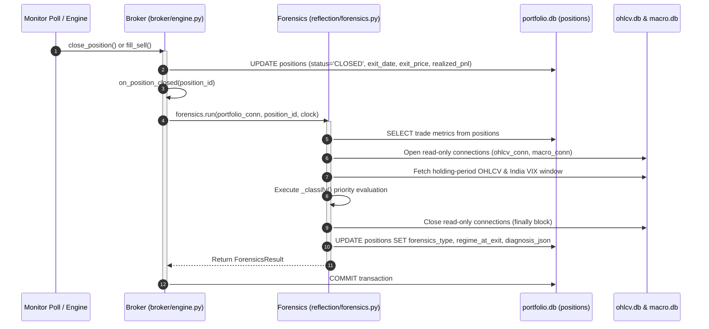

# StockMinds — System Architecture & Feature Reference Manual

This document is the single engineering reference manual detailing the architecture, implementation mechanics, invariants, data schemas, and lifecycle workflows for all major features built in the StockMinds platform.

---

## Document Index
1. [Architectural Overview & Core Invariants](#1-architectural-overview--core-invariants)
2. [Feature 01: Post-Mortem Forensics Engine (`reflection/forensics.py`)](#2-feature-01-post-mortem-forensics-engine)
3. [Feature 02: Fundamentals Ingestion Engine (`ingestion/sync_fundamentals.py`)](#3-feature-02-fundamentals-ingestion-engine)
4. [Feature 03: V3 Historical & Intraday Candle Ingestion Engine (`ingestion/sync_ohlcv.py`)](#4-feature-03-v3-historical--intraday-candle-ingestion-engine)
5. [Feature 04: Official News Ingestion & Local FinBERT Sentiment Engine (`ingestion/sync_news.py`)](#5-feature-04-official-news-ingestion--local-finbert-sentiment-engine)
6. [Upcoming Planned Features](#6-upcoming-planned-features)

---

## 1. Architectural Overview & Core Invariants

Before navigating specific features, developers must maintain these system-wide guarantees across all modules:

1. **Integer Money Representation:**
   All cash, order outlay, price limits, transaction charges, and PnL values are stored and calculated as integer paise (`_paise` suffix). Never use floating-point numbers for balance or accounting math.
2. **Deterministic Time (`Clock` Injection):**
   All business operations, job checks, and timestamps are generated in Asia/Kolkata (`IST`) via an injected `Clock` interface (`core.clock.Clock`). Production runs utilize `SystemClock()`; test suites and replays utilize `FakeClock(datetime)`. Never call raw `datetime.now()` or rely on SQLite default timestamps.
3. **Database Separation & Strict Boundaries:**
   - `portfolio.db` (State): Read/write transactions via `core.database.get_connection()`. Managed by `Broker` and scheduler jobs.
   - `ohlcv.db` (Market Data): Read-only for trading agents, screeners, and reflection. Ingested nightly via Upstox client.
   - `macro.db` (Macro Regime): Read-only for trading agents and reflection. Contains `macro_daily` records with India VIX, market trends, and regime bands.
4. **Idempotency & Re-run Safety:**
   Pipelines must never produce duplicate orders, double-close positions, or re-process past records unless explicitly directed with a `--force` flag.
5. **Pipeline Gating, Self-Healing Retries & Alerting:**
   Nightly jobs enforce strict gating (`ingestion` → `features` → `watchlist` → `agents`). If an upstream job fails, downstream tasks abort to prevent trading on stale data. To recover from transient network/API glitches, the scheduler executes checkpoint retries at 20:30 and 21:00 IST before the 22:00 agent decision window. If all checkpoints fail, a `PIPELINE_FAILED` alert is recorded to `activity_log`, escalating to `CRITICAL` on consecutive failure sessions.

---

## 2. Feature 01: Post-Mortem Forensics Engine

- **Source Module:** `reflection/forensics.py`
- **Hook Location:** `broker/engine.py` (`Broker.on_position_closed`)
- **Unit Test Suite:** `tests/unit/test_forensics.py` (18 test scenarios)
- **Integration Test Suite:** `tests/integration/test_order_lifecycle.py`
- **Specification Reference:** Plan_v3 §5.2

### 2.1 Purpose & Architectural Relevance
The Forensics Engine is a synchronous, rule-based post-mortem classification system. When an open position is liquidated or closed (via stop-loss execution, deliberate agent sell, or corporate action freeze), the engine classifies the trade outcome into a deterministic diagnostic label and persists the raw analytical metrics.

#### Why Rule-Based Python (No LLM)?
1. **Deterministic & Reproducible:** Eliminates prompt drift, hallucinations, and non-deterministic categorization.
2. **Zero Runtime Token Overhead:** Runs instantly without consuming LLM API rate limits during market-hours execution.
3. **Substrate for High-Level Reflection:** The weekly LLM reflection engine (`reflection/engine.py`) and prompt episodic memory (§5.1) ingest these structured forensic tags rather than raw, unparsed historical price data, enabling higher-quality heuristic discovery within token budgets.

---

### 2.2 Trigger & Invocation Lifecycle

The forensics engine executes synchronously as an atomic step of position closure:



#### Fault Tolerance Guarantee
`forensics.run()` wraps its execution in a `try...except Exception` block. If an unexpected error or data corruption occurs, the engine logs the traceback, defaults the diagnosis to `UNCLASSIFIED` (`matched=False`), and safely persists the record. **A forensics failure will never abort or roll back the financial closure of a position.**

---

### 2.3 Classification Taxonomy & Multi-Archetype Hierarchy (Option A)

When a trade closes, the engine resolves the agent's strategy profile via `agents.personas.get_persona(agent_id)` (Option A). This parameterizes the trade evaluation by:
- **`strategy_type`:** `MOMENTUM` (Simons, Baseline), `GARP` (Lynch), `VALUE_CONTRARIAN` (Marks), `GROWTH_COMPOUNDER` (Jhunjhunwala), or `HYBRID` (StockMinds Core).
- **`min_win_pnl_pct` & `min_win_hold_days`:** Dynamic thresholds scaled to the persona's investment horizon.
- **`eval_horizon_days`:** Horizon used to judge extended thesis failure vs normal daily volatility.

#### A. Trade Outcome Partitioning
A position is partitioned into a win or loss based on its persona-specific thresholds:
- **Win Path:** `realized_pnl_pct >= persona.min_win_pnl_pct` AND `hold_days >= persona.min_win_hold_days`
  - Simons / Baseline: $\ge 4.0\%$ and $\ge 3$ days.
  - Lynch (GARP): $\ge 10.0\%$ and $\ge 15$ days.
  - Marks (Value Contrarian): $\ge 6.0\%$ and $\ge 7$ days.
  - Jhunjhunwala (Compounder): $\ge 8.0\%$ and $\ge 10$ days.
  - Core (Hybrid): $\ge 5.0\%$ and $\ge 5$ days.
- **Loss / Breakeven Path:** All positions failing the win criteria.

#### B. Loss Path Priority Hierarchy

| Priority | Forensics Label | Applicable Archetypes | Trigger Condition | Rationale / Context |
| :---: | :--- | :--- | :--- | :--- |
| **1** | `CORP_ACTION_ARTIFACT` | All | `exit_reason == 'CORP_ACTION_CLOSE'` | Position forcibly liquidated due to corporate actions (mergers, delisting, splits) rather than strategic failure. |
| **2** | `BROAD_MARKET_DRAG` | All | India VIX regime was `ELEVATED` or `PANIC` for $\ge 50\%$ of holding days. | Systematic broad-market volatility compressed individual equities. (Proxy for Nifty-50 falling $>2\%$). |
| **3** | `REGIME_MISMATCH` | All | India VIX at exit $> 20.0$ AND VIX rose between entry and exit date. | Volatility environment worsened significantly while holding, invalidating the entry hypothesis. |
| **4** | `EARNINGS_SHOCK` | All | Single-day absolute move $\ge 7.0\%$ in ticker OHLCV within the holding window. | Unanticipated volatility/earnings event blew past the stop buffer. |
| **5** | `FALSE_BREAKOUT` | `MOMENTUM`, `HYBRID` | Daily close fell below entry price within the first 3 sessions AND session volume $< 1.2\times$ 20-day historical average. | Price reversed below breakout level without volume confirmation. **Excluded for GARP, Value, and Compounders** where initial short-term dips are normal price discovery. |
| **6** | `VALUE_TRAP` | `VALUE_CONTRARIAN` (Marks) | `hold_days >= eval_horizon_days` AND `realized_pnl_pct <= -5.0%`. | Contrarian oversold entry continued sliding over evaluation horizon without recovery. |
| **7** | `FUNDAMENTAL_DERATING` | `GARP`, `GROWTH_COMPOUNDER` (Lynch, RJ) | `hold_days >= eval_horizon_days` AND `realized_pnl_pct <= -5.0%`. | Multi-week fundamental thesis failed to compound; sustained drawdown beyond evaluation horizon. |
| **8** | `UNCLASSIFIED` | All | None of the above rules matched. | Default fallback for ordinary trade wear-down or uncaptured triggers. |

#### C. Win Path Priority Hierarchy

| Priority | Forensics Label | Applicable Archetypes | Trigger Condition | Rationale / Context |
| :---: | :--- | :--- | :--- | :--- |
| **1** | `EARNINGS_MOMENTUM` | All | Single-day absolute price move $\ge 5.0\%$ during holding window. | Strong post-earnings momentum surge catalyzed the profit. |
| **2** | `MEAN_REVERSION` | All (especially Marks, Core) | Entry RSI-14 $< 40.0$ (from `feature_snapshots`). | Profitable bounce achieved from oversold technical conditions. |
| **3** | `VALUATION_RERATING` | `GARP`, `GROWTH_COMPOUNDER` | Holding period met and win threshold achieved without shock catalysts. | Sustained multi-week fundamental compounding following Peter Lynch / Rakesh Jhunjhunwala strategy. |
| **4** | `CONTRARIAN_REBOUND` | `VALUE_CONTRARIAN` | Holding period met and win threshold achieved without shock catalysts. | Profitable recovery on deep value contrarian play following Howard Marks strategy. |
| **5** | `TREND_CONTINUATION` | `MOMENTUM`, `HYBRID` | Default win class for momentum. | Sustained trend capture following Simons momentum rules. |

---

### 2.4 Data Captured & Schema Representation

Forensics persists its output directly to the existing round-trip record in the `positions` table:

```sql
UPDATE positions
SET forensics_type = ?,
    regime_at_exit = ?,
    diagnosis_json = ?
WHERE id = ?;
```

#### Fields Description
1. **`forensics_type` (`TEXT`):**
   The classification label (e.g. `REGIME_MISMATCH`, `FALSE_BREAKOUT`, `VALUATION_RERATING`, `VALUE_TRAP`).
2. **`regime_at_exit` (`TEXT`):**
   India VIX regime band string on the trade exit date (`LOW_VOL`, `NORMAL`, `ELEVATED`, `PANIC`, or `UNKNOWN`).
3. **`diagnosis_json` (`TEXT`):**
   A structured JSON string recording the exact metrics and persona profile evaluated.

#### Example `diagnosis_json` Payload (Multi-Archetype)
```json
{
  "ticker": "TATAMOTORS",
  "agent_id": "lynch",
  "strategy_type": "GARP",
  "min_win_pnl_pct": 10.0,
  "min_win_hold_days": 15,
  "eval_horizon_days": 20,
  "entry_date": "2026-09-01",
  "exit_date": "2026-10-15",
  "hold_days": 31,
  "realized_pnl_pct": 14.85,
  "entry_price_rupees": 940.0,
  "exit_reason": "AGENT_SELL",
  "vix_at_entry": 14.2,
  "vix_at_exit": 15.1,
  "regime_at_exit": "NORMAL",
  "high_vol_regime_days": 2,
  "total_macro_days_in_window": 31,
  "max_single_day_move_pct": 3.12,
  "entry_rsi_14": 52.1,
  "vol_20d_avg_at_entry": 1650000.0,
  "ohlcv_rows_in_window": 31,
  "is_win": true,
  "forensics_type": "VALUATION_RERATING",
  "reason": "Multi-week fundamental win held 31d with return 14.85%."
}
```

---

### 2.5 Testing & Verification Strategy

- **Unit Tests (`tests/unit/test_forensics.py`):**
  - Uses isolated in-memory SQLite databases for `portfolio`, `ohlcv`, and `macro`.
  - Employs a non-closing proxy container (`_NoCloseConn`) to test connection lifecycle safety without dropping in-memory state.
  - Verifies every priority branch independently, boundary conditions (such as holding ratio thresholds), and missing-data edge cases.
- **Integration Tests (`tests/integration/test_order_lifecycle.py`):**
  - Exercises full broker order lifecycle: Nightly decision → Pending order generation → Morning quote poll fill → Position close hook → Synchronous forensics run → Field verification.

---

## 3. Feature 02: Fundamentals Ingestion Engine

- **Source Module:** `ingestion/sync_fundamentals.py`
- **Client Integration:** `ingestion/upstox_client.py`
- **Target Database:** `data/fundamental.db`
- **Feature Snapshot Hook:** `core/build_features.py`
- **Unit Test Suite:** `tests/unit/test_sync_fundamentals.py` (14 test scenarios)
- **Specification Reference:** Plan_v3 §1.1, §2.1, and `docs/upstox_findings.md`

### 3.1 Purpose & Architectural Relevance
The Fundamentals Ingestion Engine ingests financial statements, valuation/profitability ratios, and institutional shareholding patterns from Upstox's Fundamentals API into an isolated `fundamental.db`.

This substrate serves two critical purposes:
1. **Persona Decision Primitives:** Powering non-momentum fundamental personas (Peter Lynch GARP, Howard Marks Value-Contrarian, Rakesh Jhunjhunwala Growth Compounder) who filter candidates using debt-to-equity, ROCE, PEG, and cash flow ratios.
2. **Nightly Feature Merging:** Feeding these quarterly ratios into `FeatureSnapshot.features` during the nightly `core.build_features` job so that agent reasoning prompts and faithfulness validation have verified numerical ground truth.

#### Cadence Design (14-Day Refetch Interval)
Fundamental metrics (P/E, balance sheets, quarterly results) do not change daily. Querying 50+ tickers across 5 separate API endpoints daily wastes rate limits and adds unnecessary latency. The engine implements a strict 14-day cadence:
- If a ticker has synced successfully within the last 14 days, it is skipped (`skipped_fresh`).
- Tickers that have never synced, were last synced $\ge 14$ days ago, or whose last sync recorded `FAILED` are immediately scheduled.
- The `--force` CLI flag bypasses cadence checking when manual intervention is required.

---

### 3.2 Upstox API Consumption & Mapping

All fundamental endpoints consume bare ISINs (`INE...`) stripped of exchange prefixes:

| Endpoint | Method in `UpstoxClient` | Ingested Metrics |
| :--- | :--- | :--- |
| `/v2/fundamentals/{isin}/key-ratios` | `get_key_ratios(isin)` | `P/E`, `P/B`, `ROCE`, `ROE` |
| `/v2/fundamentals/{isin}/income-statement` | `get_income_statement(isin)` | Net Profit YoY change (`pat_growth_yoy_pct`), Revenue YoY change (`revenue_growth_yoy_pct`), `Profit After Tax` |
| `/v2/fundamentals/{isin}/balance-sheet` | `get_balance_sheet(isin)` | `Current Liabilities`, `Non-Current Liabilities`, `Equity Capital` |
| `/v2/fundamentals/{isin}/cash-flow` | `get_cash_flow(isin)` | `Cash flow from Operations` (CFO) |
| `/v2/fundamentals/{isin}/share-holdings` | `get_share_holdings(isin)` | `promoters`, `fii`, `mutual_funds`, `other_dii` |
| `/v2/fundamentals/{isin}/corporate-actions` | `get_corporate_actions(isin)` | `Dividend`, `Bonus`, `Split`, `Rights` (with amounts, ratios, and ex-dates) |

#### Absent Metrics & Fallbacks
Per `docs/upstox_findings.md`, `interest_coverage` and `promoter_pledge_pct` are not returned by the Upstox API. They remain `None` in the database, preserving schema compliance without introducing synthetic data.

---

### 3.3 Derived Metric Formulas & Business Rules

Because raw financial statements contain absolute rupee figures across different units, the engine parses and computes normalized derived ratios matching `core/features.py`'s `FEATURE_REGISTRY`:

1. **Price-to-Earnings Growth Ratio (PEG):**
   $$\text{PEG} = \frac{\text{P/E}}{\text{pat\_growth\_yoy\_pct}}$$
   - **Guard:** If $\text{pat\_growth\_yoy\_pct} \le 0$ or is missing, `peg` is set to `None` to prevent misleading negative ratios.
2. **Debt-to-Equity Proxy:**
   $$\text{debt\_to\_equity} = \frac{\text{Current Liabilities} + \text{Non-Current Liabilities}}{\text{Equity Capital}}$$
   - **Guard:** If $\text{Equity Capital} \le 0$ or is missing, `debt_to_equity` is set to `None`.
3. **CFO to PAT (Earnings Quality):**
   $$\text{cfo\_to\_pat} = \frac{\text{Cash flow from Operations}}{\text{Profit After Tax}}$$
   - **Guard:** If $\text{Profit After Tax} \le 0$ or is missing, `cfo_to_pat` is set to `None`.
4. **Domestic Institutional Holding (DII):**
   $$\text{dii\_holding\_pct} = \text{mutual\_funds} + \text{other\_dii}$$
   - Falls back to `dii` if individual sub-categories are not broken down.

---

### 3.4 Data Schema (`data/fundamental.db`)

The database consists of two tables created via `ensure_schema()`:

```sql
CREATE TABLE IF NOT EXISTS fundamental_sync_status (
    ticker          TEXT PRIMARY KEY,
    isin            TEXT NOT NULL,
    last_synced_at  TEXT NOT NULL,
    status          TEXT NOT NULL -- 'SUCCESS' | 'FAILED'
);

CREATE TABLE IF NOT EXISTS fundamental_ratios (
    ticker                 TEXT PRIMARY KEY,
    as_of_date             TEXT NOT NULL,
    pe                     REAL,
    pb                     REAL,
    roce_pct               REAL,
    roe_pct                REAL,
    peg                    REAL,
    debt_to_equity         REAL,
    cfo_to_pat             REAL,
    pat_growth_yoy_pct     REAL,
    revenue_growth_yoy_pct REAL,
    promoter_holding_pct   REAL,
    fii_holding_pct        REAL,
    dii_holding_pct        REAL,
    raw_json               TEXT,
    updated_at             TEXT NOT NULL
);

CREATE TABLE IF NOT EXISTS corporate_actions (
    ticker         TEXT NOT NULL,
    isin           TEXT NOT NULL,
    action_type    TEXT NOT NULL, -- 'Dividend' | 'Split' | 'Bonus' | 'Rights'
    expiry_date    TEXT,
    amount         REAL,
    ratio          TEXT,
    raw_details    TEXT,
    updated_at     TEXT NOT NULL,
    PRIMARY KEY (ticker, action_type, expiry_date)
);
```

---

### 3.5 Integration with `core/build_features.py`

When the nightly feature engine builds a `FeatureSnapshot`, it connects to `fundamental.db` via `_load_fundamental_row(fundamental_conn, ticker)`:
1. If the ticker exists in `fundamental_ratios`, the computed metrics (`pe`, `pb`, `roce_pct`, `roe_pct`, `peg`, `debt_to_equity`, `cfo_to_pat`, `pat_growth_yoy_pct`, `revenue_growth_yoy_pct`, `promoter_holding_pct`) are populated into `features_json`.
2. If `fundamental_ratios` does not have a record for that ticker (or `fundamental.db` is unavailable), those fields remain `None`.
3. Technical indicators continue to calculate uninterrupted, ensuring fault isolation.

---

### 3.6 Testing & Verification Strategy

- **Unit Tests (`tests/unit/test_sync_fundamentals.py`):**
  - **Parsing & Math:** Validates metric extraction, positive/negative growth handling for PEG, equity zero-division protection, and DII aggregation.
  - **Cadence Checks:** Validates unseen tickers, fresh (<14 days), stale (>=14 days), failed retry, and force flags.
  - **Resilience:** Simulates `UpstoxAPIError` on client calls; verifies the engine logs `FAILED` in `fundamental_sync_status` and does not crash the run.
  - **Feature Builder Integration:** Verifies that passing `fundamental_conn` into `core.build_features.run()` merges ratios into the stored `FeatureSnapshot`.

---

---

## 4. Feature 03: V3 Historical & Intraday Candle Ingestion Engine

- **Source Modules:** `ingestion/upstox_client.py`, `ingestion/sync_ohlcv.py`
- **Target Database:** `data/ohlcv.db`
- **Integrity Validation:** `core/build_features.py`
- **Unit Test Suites:** `tests/unit/test_upstox_client.py`, `tests/unit/test_sync_ohlcv.py`

### 4.1 Problem Resolution: The Same-Day EOD Clearing Gap
In Upstox's architecture, historical candle analytical storage (`/v3/historical-candle/...`) is populated during an overnight clearing batch (between 23:30 and 02:00 IST). As a consequence, nightly pipelines executing at 20:00 IST received candles only up to the previous trading day. This triggered the strict data integrity guard in `core/build_features.py` ($\ge 95\%$ of active tickers must have today's candle), halting agent decision-making.

### 4.2 Architectural Design: Historical + Intraday Dual Fetch
Upstox API V3 provides two complementary candle endpoints:
1. **Historical V3 (`GET /v3/historical-candle/:key/days/1/:to_date/:from_date`):** Retrieves the full multi-session price history up to the latest analytical clearing date.
2. **Intraday V3 (`GET /v3/historical-candle/intraday/:key/days/1`):** Retrieves the finalized, pre-aggregated full-day EOD candle for the current trading day immediately after market close (15:30 IST).

### 4.3 Execution Flow in `sync_ticker`
```
[Start sync_ticker]
       │
       ▼
Fetch Historical Candles (V3 /days/1/to/from)
       │
       ▼
Is today's date present in candles?
    ├── YES ──► Proceed to corporate action checks
    └── NO  ──► Call client.get_intraday_daily_candle(instrument_key)
                     │
                     ▼
             Is today's candle returned?
                 ├── YES ──► Append to candles array
                 └── NO / Error ──► Pass gracefully (holiday / weekend / no trades)
       │
       ▼
Run Corporate Action Overlap Detection
       │
       ▼
Upsert Candles into ohlcv.db & Evaluate Circuit Lock
```

### 4.4 Macro Flow & V3 Market Quotes Upgrades
- **FII/DII Net Cash Flow (`ingestion/sync_macro.py`):**
  Pulls daily institutional equity cash flows via `GET /v2/market/fii?data_type=NSE_EQ|CASH` and `GET /v2/market/dii?data_type=NSE_EQ|CASH`, converting IST timestamps and writing calculated `fii_net_cr` and `dii_net_cr` into `data/macro.db`.
- **Full Market Quotes V3 (`ingestion/upstox_client.py`):**
  Upgraded batch quote fetching to `GET /v3/market-quote/quotes`, unlocking 52-week extremes (`year_high`, `year_low`), official exchange price filters (`lower_circuit_limit`, `upper_circuit_limit`), and Closing Auction Session (CAS) metrics.

---

## 5. Feature 04: Official News Ingestion & Local FinBERT Sentiment Engine

- **Source Modules:** [ingestion/sync_news.py](file:///c:/Users/KIIT0001/Projects/mini-proj/New%20Build/Autonomous_Stock_Trading/ingestion/sync_news.py), [news_sentiment/sentiment.py](file:///c:/Users/KIIT0001/Projects/mini-proj/New%20Build/Autonomous_Stock_Trading/news_sentiment/sentiment.py), [ingestion/upstox_client.py](file:///c:/Users/KIIT0001/Projects/mini-proj/New%20Build/Autonomous_Stock_Trading/ingestion/upstox_client.py)
- **Target Database:** `data/news.db` (`news_articles` table)
- **Unit Test Suite:** `tests/unit/test_sync_news.py` (3 test scenarios)
- **Integration Touchpoint:** [ingestion/cli.py](file:///c:/Users/KIIT0001/Projects/mini-proj/New%20Build/Autonomous_Stock_Trading/ingestion/cli.py), [core/build_features.py](file:///c:/Users/KIIT0001/Projects/mini-proj/New%20Build/Autonomous_Stock_Trading/core/build_features.py)
- **Specification Reference:** Plan_v3 §2.4

### 5.1 Architecture & Problem Formulation
Plan_v3 requires computing `news_sentiment` (scalar float in $[-1.0, 1.0]$) and `news_article_count` per ticker for the versioned `FeatureSnapshot`, as well as feeding top 3 headlines into persona prompts (e.g., Howard Marks looking for oversold stocks on bad news, Forensics detecting `EARNINGS_SHOCK`).
Instead of fragile web scrapers or RSS feeds that misidentify company names, news is ingested directly via Upstox's official endpoint:
`GET /v2/news?category=instrument_keys&instrument_keys={comma_separated_keys}`

### 5.2 Key Invariants & Mechanisms
1. **Instrument-Key Pre-Mapped:** Articles are curated and mapped directly to NSE instrument keys by Upstox editorial desks, completely preventing false entity matching (e.g. matching tickers `IT`, `ON`, `CAN`, `OIL`).
2. **Batched Execution:** Queries up to 30 instrument keys per HTTP call. The entire 500-stock universe is covered in 17 API requests.
3. **Cumulative Rolling Database (`data/news.db`):**
   - Articles are inserted with a unique constraint `UNIQUE (instrument_key, published_time, heading)`.
   - Running the sync job accumulates an ongoing multi-week and multi-month historical record in SQLite.
4. **Incremental FinBERT Scoring Optimization:**
   - The engine checks existing articles in `news_articles` before calling FinBERT.
   - Only *newly discovered* articles are passed to `FinBertScorer.score_batch()`. Subsequent runs score 0 existing articles, reducing CPU execution time from minutes to milliseconds.
5. **Local FinBERT Pipeline:**
   - Uses `ProsusAI/finbert` via HuggingFace `pipeline("text-classification")`.
   - Computes:
     $$\text{sentiment\_score} = \text{positive\_prob} - \text{negative\_prob} \in [-1.0, 1.0]$$
     $$\text{confidence} = \max(\text{positive\_prob}, \text{negative\_prob}, \text{neutral\_prob})$$

---

## 6. Upcoming Planned Features

The following features represent subsequent phases of the StockMinds platform and will be documented in this manual as they are built:

- **Feature 05: Forward Returns Engine (`evaluation/forward_returns.py`)**
  Calculates 1, 5, 10, and 20-day returns for every agent decision (BUY, SELL, HOLD) relative to Nifty 500 benchmarks. Serves as ground truth for scoring `SEEK` and `AVOID` heuristics.
- **Feature 06: Weekly Reflection Job (`reflection/engine.py`)**
  Automated Sunday batch job analyzing closed trade forensics, maintaining per-agent watermarks, and discovering new heuristic candidates.
- **Feature 07: Heuristic Lifecycle Manager (`reflection/memory_manager.py`)**
  Machine-checked trigger evaluation and transition management (`testing` → `active` → `reinforced` → `deprecated`).
- **Feature 08: Evaluation & Faithfulness Metrics (`evaluation/faithfulness.py`, `evaluation/performance.py`)**
  Tracks agent reasoning hallucination rates and risk-adjusted alpha metrics.


